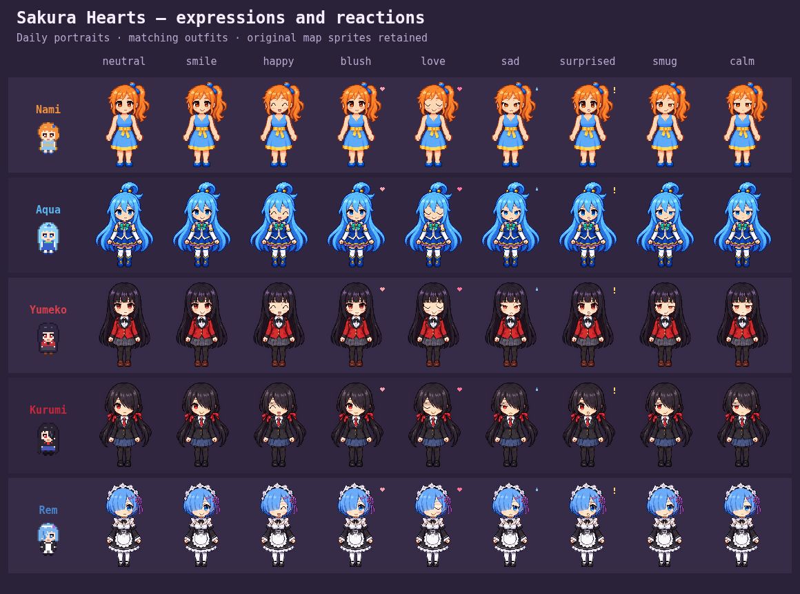
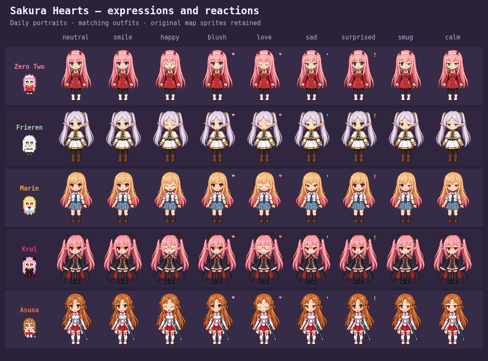
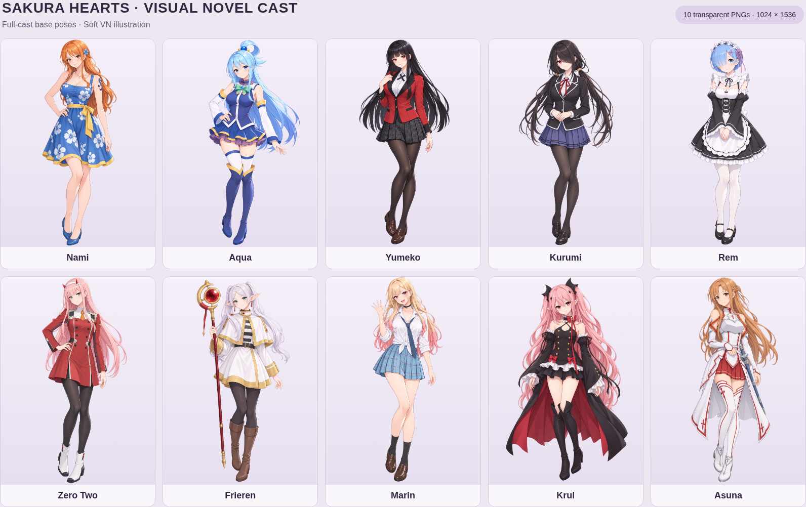

# Sakura Hearts — playable download

Download **Sakura-Hearts.zip**, extract it, then open **sakura-hearts.html** in your browser. No installation is required, and the game works offline.

This update restores the original overworld sprites. All ten girls keep their new main-outfit portraits, with nine facial expressions, blinking and brief reactions during dialogue. Alternate outfits keep their existing art.

To keep local saves, replace the older HTML at the same location with the same filename and continue using the same browser.

## Visual novel sprite artwork

[Download the full VN sprite pack](Sakura-Hearts-VN-Sprites.zip). It contains ten transparent 1024 × 1536 PNGs, one main-outfit base pose per character, plus a README and file manifest. These are new artwork assets for review; the playable game above retains its currently published artwork until integration.

